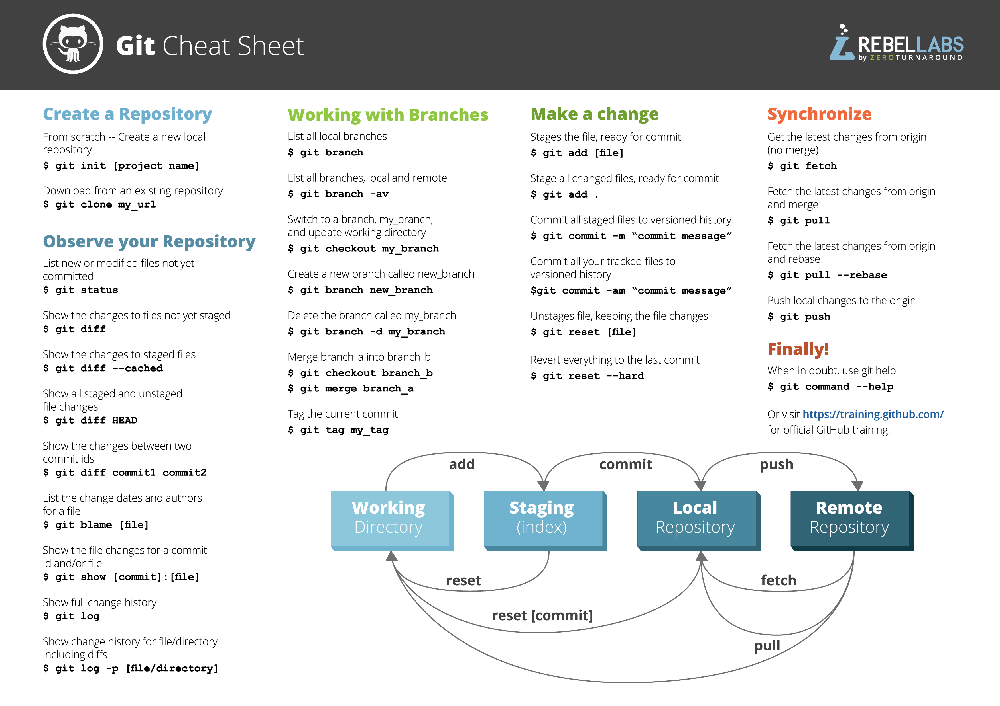

# PlutoHacks 2026 – GitHub Copilot Workshop Starter

Starter files for the PlutoHacks GitHub Copilot workshop. You'll warm up in `practice.js`, then use Copilot agent mode to build a hackathon countdown page and push it to your own GitHub.

## 1. Make your own copy

1. Click the green **Use this template** button at the top of this page, then **Create a new repository**.
2. Name it `plutohacks-countdown-test`, set it to **Public**, and click **Create repository**.
3. On your new repo, click the green **Code** button and copy the HTTPS link.

## 2. Clone it and open it in VS Code

In VS Code, open the terminal with **Ctrl + `** (the key under Esc). It opens in your user folder. Make a `GitHub` folder inside Documents, then clone into it, pasting your own link into the third line (if `mkdir` says the folder already exists, that's fine):

```bash
mkdir ~/Documents/GitHub
cd ~/Documents/GitHub
git clone https://github.com/YOUR-USERNAME/plutohacks-countdown-test.git
cd plutohacks-countdown-test
code .
```

If `code .` doesn't work, use **File → Open Folder** in VS Code and pick `plutohacks-countdown-test` in Documents → GitHub.

## 3. Turn on Copilot

Click the Copilot icon in the VS Code status bar (bottom of the window) and sign in with GitHub.

Students: get the free Copilot Student plan at https://github.com/education/students. Until you're verified, the Free plan is enough for today.

## 4. Warm-up: inline suggestions (in `practice.js`)

Type each comment, press **Enter**, then press **Tab** to accept the gray suggestion (**Esc** dismisses it).

```js
// function that takes an end date and returns the days, hours, minutes and seconds left until then
```

```js
// format that result as a string like "2d 5h 12m 3s"
```

## 5. Copilot Chat

Open chat with **Ctrl + Alt + I** (Mac: **Cmd + Ctrl + I**). Select your function in `practice.js`, then send:

```text
/explain
```

```text
/fix what happens if the end date is already in the past? Return all zeros instead of negative numbers.
```

## 6. Agent mode: build the countdown page

At the bottom of the chat box, check the dropdown to the left of **Auto** says **Agent** (it's the default, and some installs don't show **Ask** at all). Leave the model on **Auto** and send:

```text
Create a single-page countdown website for the PlutoHacks hackathon in this folder. Use plain HTML, CSS and JavaScript in three files: index.html, style.css and script.js. Hacking runs from November 6, 2026 at 7:00 PM to November 7, 2026 at 6:00 PM local time. Before hacking starts, show "Hacking starts in" and count down to the start; once it starts, show "Hacking ends in" and count down to the end. Show the days, hours, minutes and seconds, updating every second. Use a dark space theme. Do not use any frameworks or build tools.
```

Click **Keep** on the changes, then open `index.html` in your browser (double-click it, or run `start index.html` on Windows / `open index.html` on Mac).

## 7. Add features, one at a time

If a feature is tricky, click **Balance** next to **Auto** at the bottom of the chat box and pick **Intelligence** first. Then pick one prompt. Each prompt says what to change, which file to change, and what to leave alone. Send one, click **Keep**, refresh the browser to check it works, then send the next.

**When hacking ends:**

```text
When the countdown to the end of hacking (November 7, 2026 at 6:00 PM) reaches zero, stop the timer, hide the numbers, and show "Hacking is over! Submit your project" in large text in the same space theme. Only change script.js and style.css, and keep the "Hacking starts in" countdown working.
```

**Phone and resizing:**

```text
Make the page responsive so it adapts smoothly while the browser window is resized or a phone is rotated, from 320px wide up to a full desktop screen. Use a flexible CSS grid that shows the days, hours, minutes and seconds in one row on wide screens and wraps to a 2 by 2 grid on narrow ones, size the numbers and labels with clamp() so they scale with the viewport, use 100dvh instead of 100vh for full-height sections, and make sure nothing overflows or scrolls sideways. Only change style.css, and keep the current desktop look.
```

**Light and dark theme:**

```text
Add a button in the top-right corner that switches between the dark space theme and a light theme. Put the colors in CSS variables in style.css, save the choice in localStorage so it stays after a reload, and give the button an aria-label that says which theme it switches to.
```

**Confetti, with a test button:**

```text
Add a confetti animation that plays when hacking ends: a 5-second burst of confetti in colors that match the page, drawn on a full-screen canvas with plain JavaScript in script.js, no libraries. Put the canvas on top of the page but let clicks pass through it (pointer-events: none), and resize it when the window size changes. Also add a small "Test confetti" button in the bottom-right corner that plays the animation right away, so I can try it without waiting for the countdown. If the user has reduced motion turned on, skip the animation.
```

Refresh the page and click **Test confetti** to try it.

## 8. Commit and push

```bash
git add .
git commit -m "Add PlutoHacks countdown page built with Copilot"
git push
```

If a GitHub sign-in window pops up on your first push, sign in with your browser. That's VS Code signing Git in for you, so no password or token is needed.

Refresh your repo on GitHub to see your files.

**Bonus – make it a live website:** in your repo go to **Settings → Pages**, set **Source** to **Deploy from a branch**, pick `main` and `/ (root)`, and click **Save**. After a minute it's live at `https://YOUR-USERNAME.github.io/plutohacks-countdown-test/`.

## Git cheat sheet

The cheat sheet from the slides, so you don't have to screenshot it. Click it to open it full size.

[](git-cheat-sheet.png)

*Git Cheat Sheet by RebelLabs (ZeroTurnaround).*

## Want to get more into Git?

[Essential Git](https://github.com/boxwrx/essential-git) goes further into Git than today's workshop.

## Stuck?

| Problem | Fix |
| --- | --- |
| No gray suggestions | Click the Copilot icon in the status bar and check you're signed in |
| Chat answers but doesn't create or edit files | Set the dropdown to the left of **Auto** to **Agent** |
| "Author identity unknown" on commit | Run `git config --global user.name "Your Name"` and `git config --global user.email "you@example.com"` |
| `git push` asks for a password | Use **Sync Changes** in VS Code's Source Control panel |
| Page is blank | Press F12, copy the red error from the Console, and paste it into chat after `/fix` |
